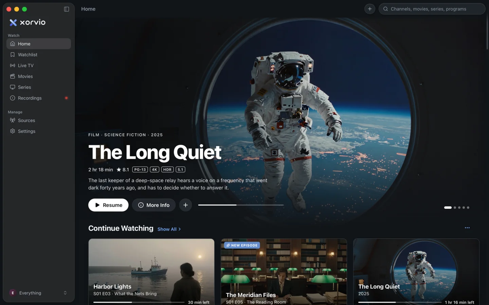
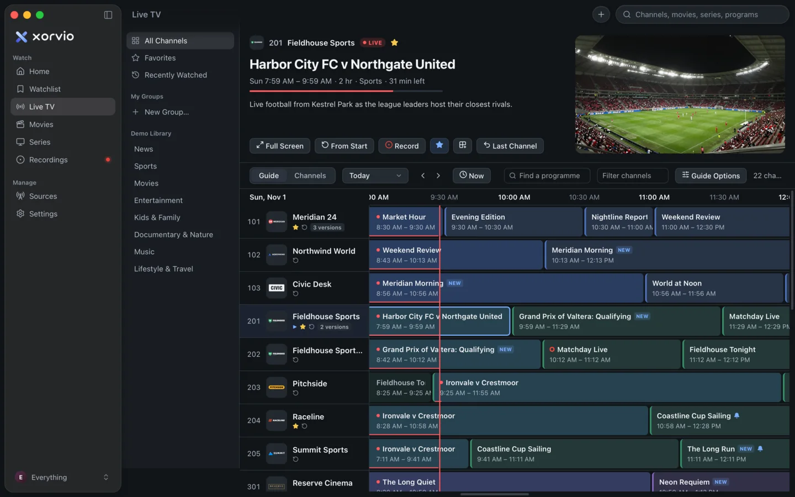

# Xorvio

**Live TV, films and series from the sources you already have, in one calm, fast app.** Free and open source for macOS, Windows and Linux.



Xorvio brings M3U playlists, Xtream Codes accounts, XMLTV guides, Plex, Jellyfin and Emby servers, your own video folders and Stremio-protocol add-ons into one library, with one search and one watchlist across all of them:

- **Live TV with a full guide**, from your playlists and providers or the tuners on your Plex, Jellyfin or Emby server: a preview that keeps playing while you browse, catch-up wherever your provider keeps an archive, and up to two hours of live TV to pause and rewind.
- **A built-in DVR**: record what's on now or schedule it from the guide, record a series' new episodes, and skip the ad breaks.
- **Film and series pages** with full-window artwork, cast and ratings, Up Next, and one watchlist for films, series and upcoming programmes (synced with Trakt if you like).
- **One search across every source**: channels, guide listings, and films and series by title, cast, director, genre or story.
- **Multiview** with four channels side by side, each one to pause, rewind and catch up on, plus a mini player, a pop-out window, Picture in Picture, AirPlay and Chromecast.
- **Plays the hard ones**: MKV, HEVC, AV1, DTS and Dolby audio, through its own bundled FFmpeg.
- **No account, ads or tracking.** Your library stays on your computer, and logins stay in your system's keychain.

Download it from [xorvio.com](https://xorvio.com) or the [releases page](https://github.com/atomtanstudio/xorvio/releases).



> Xorvio comes with no channels, films, series or add-ons, and doesn't recommend any. Connect only sources you have the right to watch. A clearly labelled demo library shows what the app can do.

## Installing a release

The downloads are on the [releases page](https://github.com/atomtanstudio/xorvio/releases) and [xorvio.com](https://xorvio.com), each with Xorvio's own ffmpeg inside.

- **macOS 12 or later:** `Xorvio_aarch64.dmg` for Apple silicon, `Xorvio_x64.dmg` for Intel. Open it and drag Xorvio to Applications. It's signed and notarized, so it opens like any other app.
- **Windows 10 or later:** `Xorvio_x64-setup.exe`, or `Xorvio_x64.msi`. These aren't code-signed yet, so Windows warns before the first run (below).
- **Linux:** `sudo apt install ./Xorvio_amd64.deb` on Debian and Ubuntu 22.04 or later, or the AppImage anywhere: `chmod +x Xorvio_amd64.AppImage`, then run it.

### "Windows protected your PC"

An unsigned installer has no publisher for Windows to check, so Microsoft Defender SmartScreen stops it the first time:

1. If the browser holds the download back as uncommon, keep it. In Edge: the download's **…** menu › **Keep** › **Show more** › **Keep anyway**.
2. Open the installer. When **Windows protected your PC** appears, click **More info**, check that the app is the file you downloaded and the publisher reads "Unknown publisher", then click **Run anyway**.

To be sure the file is the one released, compare its SHA-256 with the one the releases page shows beside it. In PowerShell, in the folder it downloaded to: `Get-FileHash .\Xorvio_x64-setup.exe`. Windows judges unsigned files one at a time, so each new version may warn again.

Windows 11's **Smart App Control**, where it's on, blocks unsigned apps outright, with no **Run anyway**, and checks them again every time they start. Windows Security › App & browser control › Smart App Control settings shows whether it is. Until Xorvio is signed, it runs only with Smart App Control off. On older builds of Windows 11, turning it off is permanent short of resetting Windows.

## Building from source

```
crates/xorvio-model    shared types (the JSON contract with the interface)
crates/xorvio-core     M3U, Xtream Codes, XMLTV, SQLite catalog + library, search
crates/xorvio-addons   Stremio-protocol add-ons
crates/xorvio-media    local media gateway (proxy, HLS rewrite, ffmpeg remux) and the recorder
src-tauri/             the Tauri app and its commands
src/                   the interface (React + TypeScript)
```

You need Rust (rustup), Node 20+ and ffmpeg. `npm run dev` alone serves the interface in a browser against the fictional demo library (src/lib/mock.ts), which is the quickest way to work on screens.

### macOS

macOS 12 or later, with Xcode or the Command Line Tools.

```bash
brew install ffmpeg
npm install
```

To build the optimized app, sign it and install it in /Applications:

```bash
npm run app
```

For development, with live reload:

```bash
npm run tauri dev
```

Both sign with a lasting certificate when the Mac has one (an "Apple Development" certificate, which Xcode makes for free under Settings › Accounts › Manage Certificates). Every build then counts as the same app, so after one "Always Allow" the Keychain stops asking for your password. `npm run tauri dev` signs its binary through `.cargo/config.toml`'s runner (Scripts/cargo-run-signed.sh); `SIGN_IDENTITY` picks a different certificate.

On this Mac, if the Command Line Tools' linker fails with "unknown architecture", build with Xcode's toolchain: `export DEVELOPER_DIR=/Applications/Xcode.app/Contents/Developer` (`npm run app` does this itself).

### Windows

Windows 10 or later, with Rust's MSVC toolchain (rustup offers to install Visual Studio's Build Tools with "Desktop development with C++"), Node, and an `ffmpeg` and `ffprobe` on `PATH` (or Xorvio's own, below). WebView2 comes with Windows 11; the installer adds it on Windows 10.

```powershell
npm install
npm run tauri dev
npm run tauri build -- --bundles nsis
```

### Linux

The packages Tauri needs, D-Bus for the keyring, and ffmpeg. On Debian and Ubuntu (22.04 or later):

```bash
sudo apt install build-essential pkg-config libwebkit2gtk-4.1-dev libayatana-appindicator3-dev \
  librsvg2-dev libssl-dev libxdo-dev libdbus-1-dev ffmpeg
npm install
npm run tauri dev
npm run tauri build -- --bundles appimage,deb
```

Xorvio keeps its secrets in the Secret Service (GNOME Keyring, KWallet), so a desktop needs one running. A development build uses the distribution's ffmpeg, which may be too old for some things (Docs/RustRewrite.md › Packaging); release packages carry their own.

### Xorvio's own ffmpeg

Releases carry their own ffmpeg and ffprobe (`xorvio-ffmpeg`, `xorvio-ffprobe`), built from upstream's source releases with only what Xorvio uses (Docs/RustRewrite.md › Packaging; licences in THIRD-PARTY.md). To build them and an app with them inside:

```bash
Scripts/build-ffmpeg.sh                 # once (a few minutes): into build/ffmpeg and src-tauri/binaries
Scripts/build-app.sh --with-ffmpeg      # macOS: as npm run app, with them inside
npx tauri build --config src-tauri/tauri.ffmpeg.conf.json    # any platform
```

The script needs a C compiler, make, curl and Python 3 (and zlib's headers on Linux: `zlib1g-dev`); it builds Meson, Ninja and NASM itself when they're missing. On Windows it runs in MSYS2's UCRT64 shell (`pacman -S zsh make diffutils curl tar xz bzip2 mingw-w64-ucrt-x86_64-{gcc,nasm,pkgconf,meson,ninja,zlib}`). Xorvio looks for its own ffmpeg next to its executable first, then any ffmpeg there, then on `PATH`, then in Homebrew's folders; `XORVIO_FFMPEG_DIR` names a folder to use instead of all of those.

### Tests

```bash
cargo test --workspace
cargo clippy --workspace --tests
npm run typecheck
XORVIO_FFMPEG_DIR=$PWD/src-tauri/binaries cargo test -p xorvio-media   # the media tests against Xorvio's own ffmpeg
```

GitHub Actions runs them on macOS, Ubuntu and Windows for every push and pull request, the tests against Xorvio's own ffmpeg (`.github/workflows/ci.yml`).

The media server sources also have tests against real servers, ignored unless asked for. `Scripts/test-servers/jellyfin-emby.sh` starts throwaway Jellyfin and Emby servers in Docker with made-up films, a series and, on Jellyfin, live TV (an M3U tuner with three test channels and an XMLTV guide; Emby's live TV needs Emby Premiere), and prints how to run `crates/xorvio-core/tests/media_servers_docker.rs` against them. `Scripts/test-servers/plex.sh` does the same for Plex's films and series; Plex's live TV needs a tuner and a claimed server, so it's tested against stand-in replies shaped like a real server's.

To try a build without touching your own library or keychain, give it another identifier and keep its logins in memory (debug builds only): `npx tauri build --debug --bundles app --config '{"identifier":"com.xorvio.desktop.test","productName":"Xorvio Test"}'`, then `open -n --env XORVIO_MEMORY_SECRETS=1 "target/debug/bundle/macos/Xorvio Test.app"`. Delete its data folder (`com.xorvio.desktop.test`) afterwards.

### Releases

1. Put the new version in `src-tauri/tauri.conf.json`, `package.json` (then `npm install` for the lock file) and `Cargo.toml`'s `[workspace.package]`, and commit.
2. Tag it and push the tag: `git tag v0.2.0 && git push origin v0.2.0`.
3. `.github/workflows/release.yml` checks the versions agree, builds macOS disk images for Apple silicon and Intel, Windows NSIS and MSI installers and a Linux AppImage and `.deb`, each with Xorvio's own ffmpeg, and puts them in a **draft** release with ffmpeg's sources and build notes, as the GPL asks. The files are named without the version (`Xorvio_aarch64.dmg`, `Xorvio_x64.dmg`, `Xorvio_x64-setup.exe`, `Xorvio_x64.msi`, `Xorvio_amd64.AppImage`, `Xorvio_amd64.deb`): xorvio.com's download buttons link to them through `releases/latest/download/`, so they follow each release with nothing to change on the site.
4. Look the draft over on GitHub (try a download on each platform), write the notes, and publish it.

Without the Apple secrets the macOS apps are signed ad hoc, and open only after System Settings › Privacy & Security › Open Anyway. To sign and notarize them, once:

1. Join the Apple Developer Program, then make a **Developer ID Application** certificate (Xcode › Settings › Accounts › Manage Certificates › + › Developer ID Application, or developer.apple.com › Certificates). Export it from Keychain Access as a `.p12` with a password.
2. For notarizing, make an **App Store Connect API key** (App Store Connect › Users and Access › Integrations › App Store Connect API, Developer access) and download its `AuthKey_<id>.p8`. An Apple ID with an app-specific password (account.apple.com › Sign-In and Security) works instead.
3. In the GitHub repository's Settings › Secrets and variables › Actions, add:

   | Secret | Value |
   | --- | --- |
   | `APPLE_CERTIFICATE` | the `.p12`, base64: `base64 -i DeveloperID.p12 \| pbcopy` |
   | `APPLE_CERTIFICATE_PASSWORD` | its password |
   | `APPLE_SIGNING_IDENTITY` | the certificate's name, as `security find-identity -v -p codesigning` shows it: `Developer ID Application: Your Name (TEAMID)` |
   | `APPLE_API_KEY`, `APPLE_API_ISSUER`, `APPLE_API_PRIVATE_KEY` | the key's ID, the issuer ID above the keys, and the `.p8` file's text |
   | or `APPLE_ID`, `APPLE_PASSWORD`, `APPLE_TEAM_ID` | the Apple ID, its app-specific password, and the team ID |
   | `XORVIO_TRAKT_CLIENT_ID`, `XORVIO_TMDB_KEY` | optional: the built-in Trakt app and TMDB key |

Nothing secret lives in the repository: the workflow passes these to Tauri only when they're set. The repository needs Actions enabled; the release jobs ask for `contents: write` themselves.

To make a signed, notarized release on a Mac instead, with the Developer ID certificate in the Keychain, store the notarization credentials there once and build:

```bash
xcrun notarytool store-credentials xorvio --key AuthKey_<id>.p8 --key-id <id> --issuer <issuer id>
#   or: xcrun notarytool store-credentials xorvio --apple-id <Apple ID> --team-id <team id>
Scripts/build-app.sh --release      # target/release/bundle/release/Xorvio_<version>_<arch>.dmg
Scripts/build-app.sh --release --target x86_64-apple-darwin   # the Intel one, on Apple silicon too
```

These can stand in for the draft release's unsigned Mac files when the repository has no Apple secrets: rename each disk image to the release's name (`Xorvio_aarch64.dmg`, `Xorvio_x64.dmg`), and archive each app as `tar czf Xorvio_<arch>.app.tar.gz -C <bundle>/macos Xorvio.app`, then `gh release upload v<version> <files> --clobber` once the release workflow has finished, so it doesn't upload over them.

`RELEASE_IDENTITY` picks another certificate and `NOTARY_PROFILE` another stored profile. Variables work too, instead of a profile: `APPLE_API_KEY`, `APPLE_API_ISSUER` and `APPLE_API_KEY_PATH` (the `.p8` file's path), or `APPLE_ID`, `APPLE_PASSWORD` and `APPLE_TEAM_ID`. A Developer ID build is a different app to the Keychain than an Apple Development one, so the Keychain asks once before it reads what the other stored. Windows installers aren't signed yet, so SmartScreen warns before the first run ([Installing a release](#installing-a-release) says what to do). Signing them would take Microsoft's Artifact Signing (an Azure subscription, open to individuals in the US and Canada), an OV certificate from a certificate authority (its key on a hardware token or in a cloud HSM), or, once the repository is public, SignPath Foundation's free signing for open-source projects, which names SignPath Foundation as the publisher. Tauri signs with any of them (`bundle.windows.signCommand`). None stops the warning at once: SmartScreen trusts a publisher as people install, but that trust carries from version to version instead of starting over with each file.

## More

- [Docs/RustRewrite.md](Docs/RustRewrite.md): how the app is put together, and the contract between its parts.
- [THIRD-PARTY.md](THIRD-PARTY.md): the software Xorvio's downloads carry, and their licences.
- [SECURITY.md](SECURITY.md): how to report a security problem privately.

Xorvio is free software under the [GNU General Public License v3.0 or later](LICENSE).
